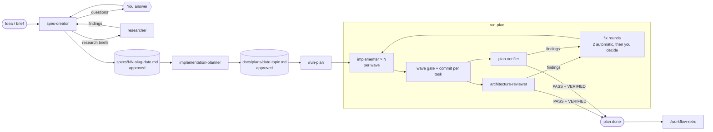

# SDD Engineering

Spec Driven Development for Claude Code: a feature goes from an idea to a
reviewed, verified branch through four agents and one orchestrating skill. Every
step writes a file — a spec, a plan, an execution log, a retro — so the work
survives `/clear` and a reviewer can see why each decision was made.

## Install

```bash
/plugin marketplace add Svyat90/dev-digest-ai-marketplace
claude plugin install sdd-engineering@dev-digest-ai-marketplace
```

Installing it also installs and enables its dependencies:

| Dependency | Range | What SDD uses from it |
|---|---|---|
| `engineering-paved-path` | `^1.0.0` | the stack and architecture skills the planner distils into task rules; `review-kit` (routing, severity, precheck) |
| `research-tools` | `^1.0.0` | `researcher`, run by the main session on the research briefs `spec-creator` returns |
| `architecture-review` | `^1.0.0` | `architecture-reviewer`, run by `/run-plan` after the waves |

## How it works



You start three steps by hand; nothing else runs on its own.

1. **Spec.** Ask Claude to run `spec-creator` with your brief (and designs, if
   any). It reads the code and curated docs, finds what the brief forgot —
   missing states, corner cases, cross-module effects, UX options — and writes a
   `draft` spec with EARS acceptance criteria (`AC1…`). Every undecided point
   becomes an open question that the main session asks you. A fact that only
   outside sources can settle (a library limit, an API behaviour, a standard)
   comes back as a *Research needed* brief instead; the main session runs
   `research-tools:researcher` on it. The agent is re-run with your answers and
   the findings until no question is left. You approve the spec; the status change
   always asks you first.
2. **Plan.** Run `implementation-planner` with the approved spec. It reviews the
   requirements, asks what is unclear, recommends improvements, and writes a
   plan: tasks with exclusive file ownership, waves that can run in parallel,
   5–15 concrete `Rules:` per task distilled from the paved-path skills, exact
   verification commands, and a mapping of every spec `AC` to a task. A lint
   checks every plan write. It ends by asking you to choose single-agent or
   multi-agent execution.
3. **Build.** `/sdd-engineering:run-plan <plan> [spec=…] [designs=…] [mode=multi|single] [extra requirements]`.
   The main session becomes an orchestrator that never writes code itself:
   - preflight: plan lint, plan and spec status, branch, working tree, environment;
   - per wave: `implementer` agents (in parallel in multi-agent mode), each
     writing its test first; reports are checked, never trusted; one gate per
     wave; one commit per task;
   - then `architecture-reviewer` ∥ `plan-verifier`; findings become fix tasks;
     two automatic fix rounds, then you decide;
   - close: full test run, insights capture, plan marked `done`.

   Everything is written to the plan's `## Execution log`, so
   `/sdd-engineering:run-plan <plan> resume` continues after `/clear`.

Afterwards, `/sdd-engineering:workflow-retro` measures the run (tokens, cache
hits, cost, parallelism, repeated reads, human friction) and proposes concrete
changes to agents and skills. It changes nothing by itself.

## Components

### Agents

| Agent | Model | Does | Writes |
|---|---|---|---|
| `sdd-engineering:spec-creator` | opus | a spec in EARS after a gap analysis of the brief, designs and code; revises it with your answers | spec files in `specs/` or `<pkg>/specs/`, their index, a *Read when* line in `<pkg>/CLAUDE.md` |
| `sdd-engineering:implementation-planner` | opus | reviews requirements and writes an Implementation Plan with waves, ownership and per-task rules | one plan in `docs/plans/` |
| `sdd-engineering:implementer` | sonnet | implements one plan task, test first, only in the files it owns | the task's files |
| `sdd-engineering:plan-verifier` | sonnet | checks shipped code against every requirement, task and acceptance criterion, with evidence | nothing |

### Skills

| Skill | Invoke | Does |
|---|---|---|
| `run-plan` | `/sdd-engineering:run-plan` | orchestrates a plan end to end (above) |
| `workflow-retro` | `/sdd-engineering:workflow-retro` | manual only: retrospective of one multi-agent run → `docs/retros/` |
| `engineering-insights` | model-invoked | reads `INSIGHTS.md` before work, appends dated non-obvious findings after it |
| `brainstorm` | model-invoked | compares feature ideas with pros and cons and records them in `brainstorm/ideas.md` |
| `mermaid-diagram` | model-invoked | one readable diagram for a spec or a plan |

### Hooks

The plugin's `hooks/hooks.json` runs four guards. Each acts only inside its own
agent and ignores every other tool call of the session:

| Hook | Agent | Does |
|---|---|---|
| `spec-creator-scope.mjs` (PreToolUse) | spec-creator | allows writes only to spec files, their index and `<pkg>/CLAUDE.md` › *Read when*; a read-only Bash allow-list; asks you before any `Status:` change |
| `spec-creator-lint.mjs` (PostToolUse) | spec-creator | lints each spec after a write and sends errors back to the agent |
| `implementation-planner-scope.mjs` (PreToolUse) | implementation-planner | allows writing only `docs/plans/<date>-<topic>.md`, and only a new or `draft` plan |
| `implementation-planner-lint.mjs` (PostToolUse) | implementation-planner | lints each plan after a write |

Hooks need `node` on `PATH`.

## Project conventions

The plugin works in any repository. It assumes these locations and creates them
on first use:

| What | Where |
|---|---|
| Packages | top-level folders with their own `CLAUDE.md`; a repo without one is a single package |
| Specs | `specs/` (single package, or a feature across packages) and `<pkg>/specs/` (one package) |
| Plans | `docs/plans/YYYY-MM-DD-<topic>.md` |
| Retros | `docs/retros/` |
| Insights | `INSIGHTS.md` at the root and in each package |
| Test policy | `TESTING.md` or the test section of `CLAUDE.md` (default: one happy path + the edge that matters) |

What the project should provide:

- typecheck and test scripts in each package's `package.json` — the planner
  writes them into each task's *Verify*. Without a test script the planner
  marks the task "no test command found" and asks you; the implementer reports
  `DONE_WITH_CONCERNS` instead of inventing a runner, and plan-verifier judges
  by reading code, marking runtime-only criteria `UNVERIFIABLE`;
- optionally `.claude/paved-path.json` (see `engineering-paved-path`) for
  package checks, do-not-touch and generated paths, coupled files; the planner
  copies its `doNotTouch` into each plan's `## Do not touch`.

## Limits

- Agents cannot ask you directly (`AskUserQuestion` is unavailable in
  subagents); the main session asks and re-runs them.
- `run-plan` never runs `spec-creator` or the planner, never pushes, and never
  opens a PR. Run `/engineering-paved-path:pr-self-review` before you do.
- The stack skills target TypeScript with React/Next.js and Fastify/Drizzle/
  PostgreSQL. Other stacks still get the workflow; the planner loads only the
  skills that match.

## Evals

`evals/` holds behavioural cases for `claude plugin eval`: one directory per
case with `prompt.md` and `graders/*.md`, plus `case.yaml` and `scaffold.sh`
when the case needs a repository (built by `evals/_fixtures/notes-app.sh`).
Each case loads this plugin and its three dependencies through `plugins:` in
`prompt.md`. They are outside this plugin's directory, so run the suite with
the marketplace root as the target:

```bash
claude plugin eval . --eval-dir plugins/sdd-engineering/evals \
  --scaffold --allow-tools Write Edit Bash
```

The skill-level `skills/*/evals/evals.json` files are for skill-creator, which
`claude plugin eval` does not read. Results go to `evals/results/` (ignored by git);
`node scripts/eval-report.mjs <results dir>` turns one into the table in
`docs/COST-BASELINE.md`.

## Versions

Release notes: [CHANGELOG.md](CHANGELOG.md). Requirements (Claude Code `>=2.1.110`, Node.js 18): [COMPATIBILITY.md](COMPATIBILITY.md). Dependency versions:

| sdd-engineering | engineering-paved-path | research-tools | architecture-review |
|---|---|---|---|
| 1.0.x | ^1.0.0 | ^1.0.0 | ^1.0.0 |

## Owner

See [CODEOWNERS](../../CODEOWNERS). Changes go through a pull request per [CONTRIBUTING.md](../../CONTRIBUTING.md).
